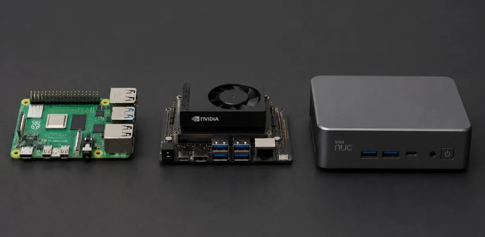
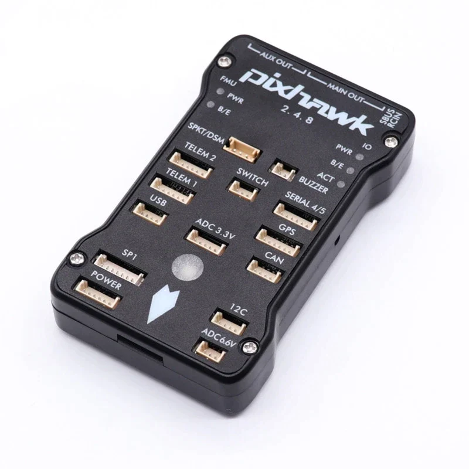
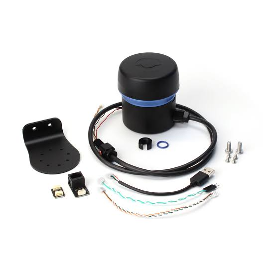
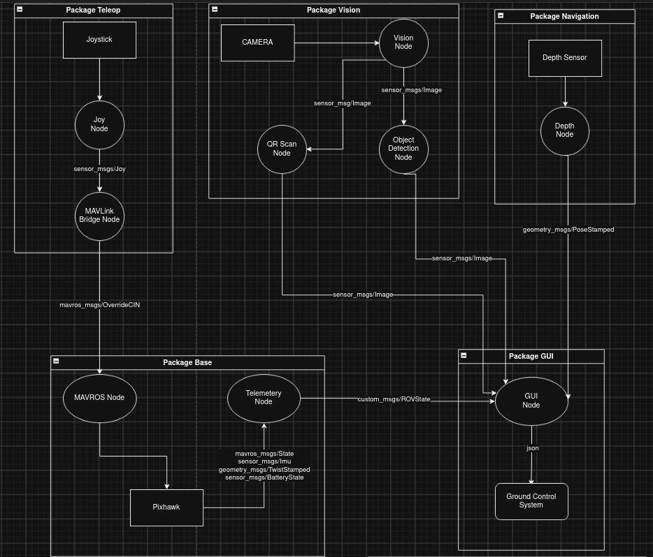

# Arsitektur ROV/AUV
 
Bagaimana struktur urutan dari sensor ke mini pc hingga sampai ke actuator?
 
Di materi ini kalian akan belajar peta besar robot kita: perangkat apa saja yang ada, bagaimana datanya mengalir, dan siapa yang memegang kendali. Sebaiknya kalian sudah membaca materi **ROS2** lebih dulu, karena di sini kita akan banyak membahas node dan topic.
 
## Daftar Isi
- [Arsitektur ROV/AUV](#arsitektur-rovauv)
  - [Daftar Isi](#daftar-isi)
  - [Hardware](#hardware)
    - [Mini PC](#mini-pc)
    - [Flight Controller](#flight-controller)
    - [Sensor](#sensor)
    - [Actuator](#actuator)
  - [Komunikasi: MAVLink dan MAVROS](#komunikasi-mavlink-dan-mavros)
  - [Diagram Utama](#diagram-utama)
    - [Jalur data naik](#jalur-data-naik)
    - [Jalur data turun](#jalur-data-turun)
    - [Teleop VS Otonom](#teleop-vs-otonom)
    - [Keselamatan](#keselamatan)
    - [Pertanyaan Checkpoint](#pertanyaan-checkpoint)
  - [Tugas](#tugas)
## Hardware
Komponen perangkat keras yang ada dalam robot bawah air.
 
### Mini PC
 


Mini PC adalah hardware pusat atau inti dari robot. Dia mengerjakan semua komputasi berat seperti menjalankan ROS2, Object Detection, pengolahan data sensor lain, dan pengambilan keputusan Behaviour Tree (Autonomous).
 
Yang perlu diingat: mini PC **tidak** menggerakkan thruster secara langsung, dan dia **bukan** penjaga keselamatan robot. Dua hal itu tugas Flight Controller.
 
### Flight Controller


Flight Controller / FC (di robot kita: Pixhawk dengan firmware ArduSub) adalah komputer kecil yang berada di antara sensor/actuator dan mini PC. Dia melakukan komputasi ringan tapi harus cepat dan konsisten, yaitu:
 
- Membaca sensor yang terhubung langsung ke FC (IMU, kompas, depth sensor).
- Memperkirakan posisi dan orientasi robot (EKF).
- Menstabilkan robot sesuai mode yang dipilih (misalnya menahan kedalaman).
- **Motor mixing**: mengubah perintah gerak seperti "maju" atau "naik" menjadi nilai untuk tiap thruster.
- Mengeluarkan sinyal PWM ke ESC.
- Menjalankan **failsafe** kalau terjadi masalah.
Gampangnya: mini PC memutuskan "mau ke mana", FC mengurus "bagaimana menggerakkan thruster supaya sampai ke sana". Kalau mini PC hang, FC tetap bisa menjaga robot tetap aman.
 
### Sensor


Komponen perangkat keras yang mendapatkan input data dari environment sekitar. Di robot kita, sensor terbagi dua kelompok berdasarkan ke mana dia terhubung:
 
| Terhubung ke | Contoh | Kenapa |
|---|---|---|
| Flight Controller | IMU, kompas, depth sensor | Dipakai FC untuk stabilisasi, jadi harus dibaca cepat dan langsung |
| Mini PC | Kamera depan, kamera bawah, sonar | Datanya besar dan butuh komputasi berat (deteksi objek dll) |
 
### Actuator


Komponen perangkat keras yang mengeluarkan output. Di robot kita actuator utamanya adalah **thruster**. Thruster tidak dihubungkan langsung ke FC, tapi lewat **ESC** (Electronic Speed Controller) yang mengubah sinyal PWM dari FC menjadi daya untuk motor thruster.
 
Umumnya sinyal PWM bernilai sekitar 1100 sampai 1900 µs, dengan 1500 µs berarti thruster diam, di bawahnya mundur, di atasnya maju.
 
## Komunikasi: MAVLink dan MAVROS
Mini PC dan FC berbicara memakai protokol **MAVLink** lewat kabel serial/USB. Masalahnya, ROS2 tidak mengerti MAVLink secara langsung. Di sinilah **MAVROS** berperan sebagai penerjemah:
 
```
Pixhawk  <== MAVLink ==>  MAVROS (node ROS2)  <== topic/service ROS2 ==>  node lain
```
 
- Dari FC ke ROS2: pesan MAVLink diubah jadi topic ROS2 (status, IMU, baterai, dll).
- Dari ROS2 ke FC: topic/service ROS2 diubah jadi pesan MAVLink (perintah gerak, arm/disarm, ganti mode).
Jadi node kita yang lain tidak perlu tahu detail MAVLink, cukup publish/subscribe ke topic MAVROS.
 
## Diagram Utama
Diagram pertama menunjukkan **hardware**: siapa terhubung ke siapa.
 


Diagram kedua menunjukkan **software ROS2** di mini PC. Cara bacanya: kotak besar adalah *package*, lingkaran adalah *node*, dan label pada panah adalah *tipe message* yang dikirim lewat topic.
 


| Package | Isi | Tugas |
|---|---|---|
| Teleop | Joy Node, MAVLink Bridge Node | Mengubah input joystick jadi perintah gerak |
| Vision | Vision Node, QR Scan Node, Object Detection Node | Mengambil gambar kamera dan mengolahnya |
| Navigation | Depth Node | Mengolah data kedalaman |
| Base | MAVROS Node, Telemetry Node | Penghubung ke Pixhawk dan pengumpul status robot |
| GUI | GUI Node | Menampilkan data ke Ground Control System |
 
<!-- TODO: di flowhw.png depth sensor terhubung ke Pixhawk, tapi di flowros.png Depth Sensor langsung ke Depth Node. Samakan salah satunya. -->
 
### Jalur data naik
Jalur data naik adalah perjalanan data dari dunia luar sampai ke mini PC.
 
**Data dari Pixhawk (status, orientasi, baterai, kedalaman):**
 
1. Sensor membaca kondisi (IMU, kompas, depth sensor) dan Pixhawk mengolahnya.
2. Pixhawk mengirim hasilnya lewat MAVLink ke mini PC.
3. **MAVROS Node** mengubahnya jadi topic ROS2, contohnya `mavros_msgs/State`, `sensor_msgs/Imu`, `geometry_msgs/TwistStamped`, dan `sensor_msgs/BatteryState`.
4. **Telemetry Node** menggabungkannya jadi satu message `custom_msgs/ROVState`.
5. **GUI Node** menerima dan menampilkannya ke Ground Control System (dalam format JSON).
**Data dari kamera:**
 
1. Kamera terhubung langsung ke mini PC (tidak lewat Pixhawk).
2. **Vision Node** mengambil gambar dan mem-publish `sensor_msgs/Image`.
3. **QR Scan Node** dan **Object Detection Node** sama-sama subscribe ke gambar itu dan memprosesnya.
4. Hasilnya diteruskan ke GUI Node.
Perhatikan bahwa satu gambar bisa dipakai banyak node sekaligus. Inilah keuntungan sistem publish/subscribe.
 
### Jalur data turun
Jalur data turun adalah perjalanan perintah dari mini PC sampai thruster berputar.
 
1. Operator menggerakkan **joystick**.
2. **Joy Node** membaca joystick dan mem-publish `sensor_msgs/Joy`.
3. **MAVLink Bridge Node** menerjemahkan input joystick menjadi perintah gerak, lalu mem-publish `mavros_msgs/OverrideRCIn` (topic `/mavros/rc/override`).
4. **MAVROS Node** mengubahnya jadi pesan MAVLink dan mengirimnya ke Pixhawk.
5. **Pixhawk (ArduSub)** melakukan motor mixing: perintah "maju" jadi nilai untuk tiap thruster.
6. Pixhawk mengeluarkan **PWM** ke **ESC**.
7. **ESC** menggerakkan motor **thruster**.
`OverrideRCIn` bekerja seolah-olah perintah datang dari remote control biasa. Tiap channel mewakili satu sumbu gerak (secara default di ArduSub: pitch, roll, throttle/naik-turun, yaw, forward, dan lateral). Cek dokumentasi ArduSub untuk versi yang dipakai kalau ingin memastikan nomor channel-nya.
 
Satu hal penting: **Pixhawk harus dalam keadaan armed** sebelum thruster merespons. Arm/disarm dan pergantian mode (misalnya MANUAL, STABILIZE, DEPTH_HOLD) juga dikirim lewat MAVROS.
 
### Teleop VS Otonom
Robot kita bisa dikendalikan dengan dua cara, dan keduanya berakhir di jalur yang sama menuju MAVROS:
 
| | Teleop | Otonom |
|---|---|---|
| Siapa yang memutuskan | Manusia lewat joystick | Behaviour Tree |
| Sumber data | Input joystick | Hasil Vision, Navigation, dan Telemetry |
| Jalurnya | Joystick → Joy Node → MAVLink Bridge → MAVROS | Sensor/Vision → Behaviour Tree → MAVLink Bridge → MAVROS |
 
```
Joystick ──► Joy Node ──────────────┐
                                    ├──► MAVLink Bridge ──► MAVROS ──► Pixhawk
Vision/Depth/Telemetry ──► BT ──────┘
```
 
Masalahnya: kalau dua sumber mengirim perintah bersamaan, siapa yang menang? Karena itu harus ada aturan jelas bahwa **hanya satu sumber yang aktif pada satu waktu**, dan operator selalu bisa **mengambil alih** lewat joystick (misalnya dengan menekan tombol tertentu). Cara kerja Behaviour Tree sendiri dibahas di materi Behaviour Tree.
 
### Keselamatan
Karena robot bekerja di bawah air dan thruster berbahaya, beberapa aturan dasar:
 
- **Disarm** robot sebelum menyentuh thruster atau mengerjakan hardware.
- Pixhawk punya **failsafe** (misalnya saat koneksi hilang, ada kebocoran, atau baterai drop), jadi pastikan pengaturannya dicek sebelum uji coba.
- Jangan pernah mengandalkan mini PC saja untuk keselamatan. Keputusan darurat harus bisa dijalankan Pixhawk sendiri.
### Pertanyaan Checkpoint
Coba jawab sendiri sebelum lanjut ke tugas:
 
1. Kenapa depth sensor dihubungkan ke Pixhawk, sedangkan kamera ke mini PC?
2. Apa yang terjadi kalau MAVROS Node mati? Bagian mana yang masih jalan, bagian mana yang berhenti?
3. Kenapa perintah ke thruster tidak dikirim langsung dari mini PC ke ESC?
4. Kalau joystick dan Behaviour Tree mengirim perintah bersamaan, apa masalahnya?
## Tugas
 
Coba kalian buat diagram flow data ROS2 dengan tambahan pixhawk ke thruster dan menghilangkan package GUI.
 
Syarat tugas:
 
1. Gunakan notasi yang sama dengan diagram di atas (package, node, label tipe message).
2. Tambahkan jalur dari MAVROS ke Pixhawk, lalu ke ESC dan thruster.
3. Tandai jalur data naik dan jalur data turun dengan warna yang berbeda.
4. Tulis satu paragraf pendek: jika kamera mati, bagian mana dari robot yang masih bisa bekerja?
Kalian bisa menggambar memakai [draw.io](https://app.diagrams.net/) lalu mengekspornya ke PNG.
 
