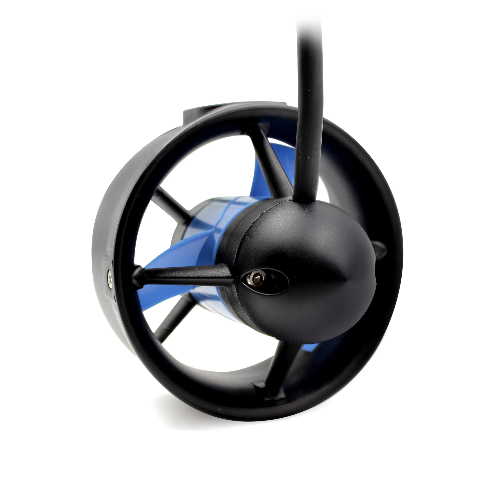
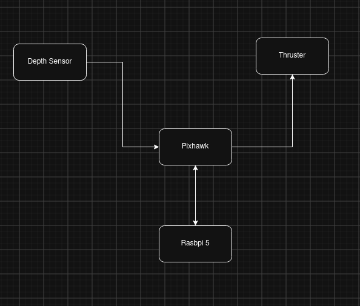

# Arsitektur ROV/AUV
Bagaimana struktur urutan dari sensor ke mini pc hingga sampai ke actuator?

## Hardware
Komponen perangkat keras yang ada dalam robot bawah air.

### Mini PC

Mini PC adalaha hardware pusat atau inti dari robot, dia mengerjakan semua komputasi berat seperti menjalankan ROS2, Object Detection, Pengolahan data sensor lain, dan Pengambilan keputusan behaviour Tree (Autonomous)

### Flight Controller

Flight Controller / FC adalah hardware yang berada diantara sensor/actuator dengan mini pc. Dia bertugas melakukan komputasi ringan untuk mengolah data PWM masuk dan PWM keluar antara sensor/actuator dengan mini pc.

### Sensor

Komponen perangkat keras yang mendapatkan input data dari environment sekitar.

### Actuator

Komponen perangkat keras yang mengeluarkan output.

## Diagram Utama

### Jalur data naik

### Jalur data turun

### Teleop VS Otonom

## Tugas

Coba kalian buat diagram flow data ROS2 dengan tambahan pixhawk ke thruster dan menghilangkan package GUI